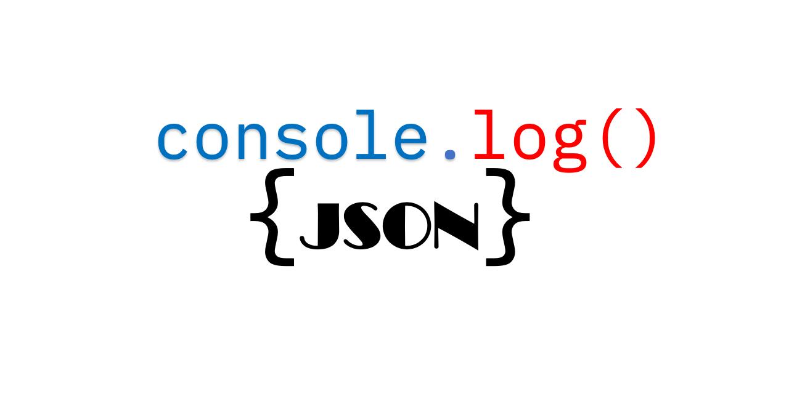
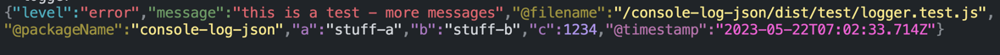

# console-log-json

<!-- markdownlint-disable -->

<!--suppress HtmlDeprecatedAttribute -->

<!-- ALL-CONTRIBUTORS-BADGE:START - Do not remove or modify this section -->
[](#contributors-)
<!-- ALL-CONTRIBUTORS-BADGE:END -->

[](https://www.npmjs.com/package/console-log-json)

**Drop-in structured JSON logging for Node.js and the browser. Zero required dependencies. No vendor lock-in. One line to set up. TypeScript types included.**

Replace `console.log()` with production-grade JSON output -- no code changes required across your entire codebase, and no logger API to couple your application to.

```js
import { LoggerAdaptToConsole } from "console-log-json";
LoggerAdaptToConsole();

// Every console.log, console.error, console.warn, etc. now outputs structured JSON
console.log("user signed in", { userId: 42, plan: "pro" });
```

```json
{"level":"info","message":"user signed in","@filename":"my-app/src/auth/login.ts","@logCallStack":"at login (/my-app/src/auth/login.ts:12:11)\n    at ...","@packageName":"my-app","plan":"pro","userId":42,"@timestamp":"2025-01-15T08:30:00.000Z"}
```

---

console-log-json is built for developers who already have `console.*` calls throughout a codebase and want structured logs without a logger migration. Install it with `npm`, turn it on once, and keep shipping the same application code while getting JSON that log platforms can ingest immediately. Because it hooks the standard console API instead of making you thread a logger instance through your app, it is easy to add to an existing codebase and easy to remove later if you ever change direction.

## At a Glance

- Built for developers: keep using `console.log`, `console.error`, and friends while emitting structured JSON.
- Self-serve adoption: `npm install console-log-json`, call `LoggerAdaptToConsole()`, and try it immediately.
- Low application coupling: your app keeps using the standard console API instead of a library-specific logger object.
- Useful in everyday development and production: easier debugging, searchable logs, cleaner ingestion in DataDog, Splunk, OpenSearch, CloudWatch, and ELK.
- Works across Node.js and browser builds, with support for ESM, CommonJS, and bundled frontend apps.
- Power-user features include redaction, output transforms, log interception hooks, log-level control, and env-var configuration.
- Designed to be operationally safe: no required runtime dependencies, crash-safe fallbacks, and compatibility with older Node.js runtimes (`>=10` for CommonJS, `>=12.20` for ES module imports).

## Contents

- [Why Developers Use It](#why-developers-use-it)
- [Quick Start](#quick-start)
- [Common Usage Patterns](#common-usage-patterns)
- [Supported Console Methods](#supported-console-methods)
- [Configuration](#configuration)
- [API Reference](#api-reference)
- [Browser Usage](#browser-usage)
- [Advanced Usage](#advanced-usage)

## Why Developers Use It

This library is a strong fit when you want structured logging to become part of the normal development flow without rewriting application code.

- Keep existing `console.*` calls and upgrade their output in one place.
- Avoid logger lock-in: application code stays on the standard console API instead of depending on a special logging object.
- Adopt it without talking to sales, spinning up infrastructure, or learning a new logging API.
- Use the same library in Node.js services and browser bundles.
- Add power-user features only when you need them: redaction, hooks, transforms, and runtime configuration.

| | console-log-json | winston / pino / bunyan |
|---|---|---|
| **Setup** | 1 line, drop-in | Rewrite every log call |
| **Application coupling** | Standard `console.*` API | Special logger instance / library API |
| **Dependencies** | Zero required (one optional) | 5-30+ transitive deps |
| **Browser support** | Yes | No (Node only) |
| **Argument handling** | Throw anything in any order | Strict API signatures |
| **Stack traces** | Automatic, single-line | Manual formatting |
| **Source file tracking** | Automatic `@filename` on every log | Not built-in |
| **Crash safety** | Logger errors never crash your app | Depends on config |

### Zero required dependencies

No `winston`. No `pino`. No `bunyan`. No dependency tree to audit and no version conflicts. The logger itself is self-contained.

The one exception is an **optional** dependency, [`source-map-support`](https://www.npmjs.com/package/source-map-support), which npm installs by default. On Node.js it maps stack-trace lines back to your TypeScript sources. If it's missing (for example with `npm install --omit=optional`, or in the browser), the logger works the same, with stack traces pointing at the compiled JavaScript.

### Drop-in replacement -- no code changes needed

Call `LoggerAdaptToConsole()` once at startup. Every `console.log()`, `console.error()`, `console.warn()`, `console.info()`, `console.debug()` across your entire codebase -- including third-party libraries -- instantly outputs structured JSON. So do `console.trace()`, `console.table()`, `console.dir()`, `console.assert()`, `console.count()` and `console.time()` (see [Supported Console Methods](#supported-console-methods)). No find-and-replace. No import changes.

That same design keeps your application code decoupled from the logger. Unlike libraries that require a dedicated logger instance such as `logger.info(...)`, your code continues to use the platform-standard console API. If you later decide to remove `console-log-json` or replace it with something else, the change is typically concentrated at initialization instead of spread across the whole application.

### Throw anything at it

Strings, numbers, booleans, objects, errors, circular references, `null`, `undefined` -- in any order, in any combination. The logger figures it out and produces consistent, parseable JSON every time.

```js
console.log("request failed", 500, new Error("timeout"), { endpoint: "/api/users" }, null);
```

```json
{"level":"error","message":"request failed - 500 - timeout","endpoint":"/api/users","errCallStack":"Error: timeout\n    at ...","@timestamp":"..."}
```

### Single-line JSON for log ingestion

Every log entry is a single line of JSON, ending with one `\n`. Stack traces, nested objects, multi-line error messages -- all flattened to one line (newlines inside values are escaped as `\n`, as JSON requires). This is the format that log management tools like **DataDog**, **LogDNA**, **Splunk**, **OpenSearch**, **CloudWatch**, and **ELK** are designed to ingest. The output uses standard field names (`level`, `message`, `@timestamp`) that most tools recognize automatically or with minimal field mapping. No more multi-line log entries getting split into separate events or interleaved with other logs.

### Automatic metadata on every log

Every log entry automatically includes contextual information that would be tedious and error-prone to add manually:

- **`@timestamp`** -- ISO 8601 UTC timestamp. Essential for correlating events across services, tracking the order of operations during incident response, and querying logs by time range. Always in UTC so there's no timezone ambiguity across distributed systems.
- **`@filename`** -- the best-effort source file that generated the log, as a path starting at your project's folder name (for example `my-app/src/auth/login.ts`). In normal Node.js and unbundled browser builds, this usually points to the caller you care about. If a consumer bundles `console-log-json` together with app code into a single browser file, there may be no reliable boundary in the stack between library frames and app frames, so `@filename` can fall back to `<unknown>` or a bundle path.
- **`@logCallStack`** -- the full call stack at the point of logging. Shows you not just *where* the log was called, but *how the code got there*. Invaluable for tracing execution paths through middleware chains, event handlers, and deeply nested function calls.
- **`@packageName`** -- the npm package name from `package.json`. In monorepos or microservice architectures where multiple packages log to the same stream, this tells you which service or package produced the log without relying on container labels or deployment metadata. In Node.js, this works in both CommonJS and ESM projects. If the package name cannot be determined, the field is omitted rather than emitting a placeholder value.

No manual tagging. No `logger.info("msg", { file: __filename })`. It just works.

### Built-in structured redaction

Sensitive fields can be redacted with a Pino-style `redact` option using explicit object paths. This keeps secrets like passwords, bearer tokens, API keys, and cookies out of logs without relying on brittle regexes over whole log lines.

```js
LoggerAdaptToConsole({
  redact: ['password', 'headers.authorization', 'payment.card.number']
});
```

Redaction is applied to the final structured log object, so it also covers fields added by `transformOutput`. The original objects passed to `console.log(...)` are not mutated.

### Crash-safe by design

The logger will **never** crash your application. Every code path in the logging pipeline is wrapped in try/catch. If anything goes wrong during log formatting, the logger falls back silently. Your `console.log()` call will never throw an exception, even with the most exotic inputs.

### Browser compatible

Works in Node.js and in the browser. Node-specific features (file detection) degrade gracefully instead of crashing. `@filename` is best-effort in the browser and may show `<unknown>` or a bundle path, especially when the library and app are bundled into one file. Ship the same logging code to your server and your frontend.

### Performance-conscious

- **One shared stack string** per log call for `@logCallStack` and stack-based fallback, plus a V8 callsite lookup for `@filename` when available
- **Env vars cached** at init time, not read on every log call
- **Redaction paths compiled once** at initialization, not reparsed on every log call
- **Pre-compiled regex** for stack trace parsing
- **No JSON round-trip cloning** -- deep clone uses a visited-object map
- **No blocking I/O** in the logging hot path

---

## Quick Start

### Install

```bash
npm install console-log-json
```

### Initialize

ESM:

```js
import { LoggerAdaptToConsole } from "console-log-json";
LoggerAdaptToConsole();
```

CommonJS:

```js
const { LoggerAdaptToConsole } = require("console-log-json");
LoggerAdaptToConsole();
```

That's it. Every `console.log()` in your codebase now outputs JSON.

CommonJS `require` works on Node.js 10 and later. ES module `import` needs Node.js 12.20 or later.

In Node ESM projects, very early startup logs may be buffered briefly while `@packageName` is resolved from `package.json`, then emitted normally.

### Restore original console (optional)

```js
import { LoggerRestoreConsole } from "console-log-json";
LoggerRestoreConsole();
```

---

## Common Usage Patterns

Start with the first few examples to understand the default behavior, then use the later sections as a cookbook for less common cases.

### Basic message

```js
console.log("server started on port 3000");
```

```json
{"level":"info","message":"server started on port 3000","@filename":"my-api/src/index.ts","@logCallStack":"at ...","@packageName":"my-api","@timestamp":"2025-01-15T08:30:00.000Z"}
```

### Message with context

```js
console.log("order placed", { orderId: "ORD-123", total: 59.99, items: 3 });
```

```json
{"level":"info","message":"order placed","items":3,"orderId":"ORD-123","total":59.99,"@timestamp":"..."}
```

Context properties are extracted to the top level and sorted alphabetically, nested objects included, for consistent, easy-to-parse output.

### Error with context

```js
console.log("payment failed", new Error("card declined"), { customerId: "C-456", amount: 99.99 });
```

```json
{"level":"error","message":"payment failed - card declined","@errorObjectName":"Error","amount":99.99,"customerId":"C-456","errCallStack":"Error: card declined\n    at ...","@timestamp":"..."}
```

- Log level is automatically set to `error` when an Error object is present, even when using `console.log()`
- The error message is appended to your message string
- The full stack trace is included in `errCallStack`
- Context properties are merged in alongside

### ErrorWithContext for richer error handling

A common frustration in production debugging: you see `"connection refused"` in the logs but have no idea *which* query, *which* user, or *which* table caused it. `ErrorWithContext` solves this by letting you attach structured context to errors as they bubble up through your code, without losing the original stack trace.

```js
import { ErrorWithContext } from "console-log-json";

try {
  await db.query("SELECT * FROM users WHERE id = $1", [userId]);
} catch (err) {
  // Wrap the original error with additional context -- the original stack trace is preserved
  throw new ErrorWithContext(err, { userId, operation: "getUser", table: "users" });
}
```

```json
{"level":"error","message":"connection refused","@errorObjectName":"Error","errCallStack":"Error: connection refused\n    at ...\nCaused By: Error: connection refused\n    at ...","operation":"getUser","table":"users","userId":42,"@timestamp":"..."}
```

Now when you see this error in your log dashboard, you can immediately filter by `userId: 42` or `table: "users"` to understand the scope of the problem. You can nest multiple `ErrorWithContext` wrappings -- each layer adds context, and the full causal chain is preserved with `Caused By:` in the stack trace.

### Strings, numbers, booleans -- any order

```js
console.log("response", 200, "OK", { duration: 45 }, true);
```

```json
{"level":"info","message":"response - 200 - OK - true","duration":45,"@timestamp":"..."}
```

Strings, numbers, and booleans are concatenated into the message. Objects are extracted as top-level properties. The order you pass them doesn't matter.

### Multiple context objects are merged

```js
const userInfo = { firstName: "Homer", lastName: "Simpson" };
const requestInfo = { ip: "10.0.0.1", method: "POST" };
console.log("login attempt", userInfo, requestInfo);
```

```json
{"level":"info","message":"login attempt","firstName":"Homer","ip":"10.0.0.1","lastName":"Simpson","method":"POST","@timestamp":"..."}
```

### Key collisions

Nothing is silently overwritten. When two objects have the same key, the first one keeps the name and later ones get an `_` prefix (`_a`, then `__a`, and so on). Keys are compared case-insensitively.

```js
console.log("x", { a: 1 }, { a: 2 }, { A: 3 });
```

```json
{"level":"info","message":"x","__A":3,"_a":2,"a":1,"@timestamp":"..."}
```

- **Context passed to the call beats `customOptions`.** With `customOptions: { service: "api" }`, `console.log("x", { service: "mine" })` logs `"service":"mine","_service":"api"`. With [`contextKey`](#nesting-context-under-a-single-key-clean-top-level-schema) set they can't collide, because call context is nested and `customOptions` stay at the top level.
- **A `level` field that isn't a log level** (e.g. `{ level: 5 }`) is kept as `_level`, since `level` holds the log level.
- **A `message` string field** is joined onto the message instead (see [Reserved `message` handling](#reserved-message-handling)).
- **Redaction covers the renamed copies:** the path `password` also redacts `_password`, `__password`, ...

### Circular references are handled safely

In real applications, objects with circular references are common -- Express request objects, Mongoose documents, socket instances, DOM nodes. Most loggers choke on these with `TypeError: Converting circular structure to JSON`. console-log-json handles them gracefully.

```js
const obj = { name: "test" };
obj.self = obj;
console.log("circular", obj);
```

```json
{"level":"info","message":"circular","name":"test","self":{"name":"test","self":"[Circular ~.self]"},"@timestamp":"..."}
```

The object is copied until a reference repeats; the repeat becomes a `[Circular ~<path>]` marker naming where the object was first seen.

### Explicit log level override

Sometimes you want to use `console.log()` but control the log level -- for example, when a function dynamically decides the severity. Pass a `{ level: "..." }` object as any parameter.

```js
console.log({ level: "warn" }, "disk usage at 90%", { partition: "/dev/sda1" });
```

```json
{"level":"warn","message":"disk usage at 90%","partition":"/dev/sda1","@timestamp":"..."}
```

Supports `error`, `err`, `warn`, `warning`, `info`, `information`, `http`, `verbose`, `debug`, `silly`, in any letter case. Aliases like `err` and `warning` are normalized automatically.

Rules:

- `level` must be the object's **first** key. Other keys in the same object are kept as context.
- Only the **first** matching object counts.
- The override **wins over an Error**: `console.log({ level: "warn" }, new Error("degraded"))` is logged at `warn`, with `errCallStack`. Without an override, any Error makes the log `error`.
- The override is also what [log level filtering](#log-level-filtering) checks.
- A value that isn't a log level (e.g. `{ level: 5 }`) is not an override; it is kept as data (see [Key collisions](#key-collisions)). A `level` property on an Error object is never an override.

### JSON string auto-parsing

Third-party libraries and APIs often emit pre-formatted JSON strings. Rather than logging these as opaque strings (making them impossible to filter or query on individual fields), console-log-json automatically detects JSON in your messages and extracts it into a structured `@autoParsedJson` property.

```js
console.log('{"event":"webhook","source":"stripe","type":"payment.succeeded"}');
```

```json
{"level":"info","message":"<auto-parsed-json-string-see-@autoParsedJson-property>","@timestamp":"...","@autoParsedJson":{"event":"webhook","source":"stripe","type":"payment.succeeded"}}
```

Now you can query `@autoParsedJson.source = "stripe"` in your log dashboard instead of doing substring searches on a raw message. This can be disabled with `CONSOLE_LOG_JSON_DISABLE_AUTO_PARSE=true` if you prefer the raw string.

### Reserved `message` handling

The logger treats `message` as a reserved field and handles it consistently:

- if you pass a normal string message, it stays the canonical `message`
- if a context object also contains `message: "..."`, it is merged into the canonical message with ` - `
- if a context object contains `message: { ... }`, that object is preserved under `@messageObject`

```js
console.log('dude', { message: 'hi there', cont: { key: 'value' } });
```

```json
{"level":"info","message":"dude - hi there","cont":{"key":"value"},"@timestamp":"..."}
```

```js
console.log({ message: { key: 'value' } });
```

```json
{"level":"info","message":"<no-message-was-passed-to-console-log>","@messageObject":{"key":"value"},"@timestamp":"..."}
```

### Placeholder messages

Every entry has a `message`. When there isn't a real one, the logger writes a fixed placeholder you can search for:

| Placeholder | When |
|---|---|
| `<nothing-was-passed-to-console-log>` | The call had no message and no data: `console.log()`, `console.log("")`, `console.log({})`. |
| `<value-passed-to-console-log-json-was-null>` | The only arguments were `null` or `undefined`: `console.log(null)`. |
| `<no-message-was-passed-to-console-log>` | There is data but no message: `console.log({ userId: 1 })`, `console.dir(obj)`, or a `message` object moved to `@messageObject`. |
| `<no-error-message-was-passed-to-console-log>` | The same, for an error log: `console.error(new Error(""))`. |
| `<auto-parsed-json-string-see-@autoParsedJson-property>` | The message was a JSON string and was moved to `@autoParsedJson` (see [JSON string auto-parsing](#json-string-auto-parsing)). |
| `<console-table>` | A `console.table()` call; the data is in `@table`. |

### BigInt values

JSON has no BigInt type, so BigInt values are written as strings, with every digit kept. A BigInt argument becomes part of the message, like a number:

```js
console.log("balance", 10n, { total: 9007199254740993n });
```

```json
{"level":"info","message":"balance - 10","total":"9007199254740993","@timestamp":"..."}
```

### Static properties on every log (service name, environment, etc.)

In microservice and containerized environments, SRE teams need to filter logs by service, environment, region, deployment version, or pod name. Rather than adding these to every log call, set them once at startup and they're automatically included on every line.

```js
LoggerAdaptToConsole({
  customOptions: {
    service: "payment-api",
    environment: "production",
    region: "us-east-1"
  }
});

console.log("health check passed");
```

```json
{"level":"info","message":"health check passed","environment":"production","region":"us-east-1","service":"payment-api","@timestamp":"..."}
```

Now every log from this service is filterable by `service: "payment-api"` in DataDog, OpenSearch, or any log aggregator -- without modifying a single log call across the codebase.

### Nesting context under a single key (clean top-level schema)

By default, properties from context objects are flattened to the top level of the JSON output. This is great for tools like LogDNA that only filter on top-level fields, but it can be a problem for teams using DataDog, OpenSearch, or Splunk -- "random" properties appearing at the top level can interfere with dashboards, alerts, and saved filters.

Set `CONSOLE_LOG_JSON_CONTEXT_KEY` to nest all user-provided context under a single, predictable key:

```bash
CONSOLE_LOG_JSON_CONTEXT_KEY=context
```

```js
console.log('order placed', { orderId: 'ORD-1', total: 59.99 }, { items: 3 });
```

**Without** the option (default -- flattened to top level):
```json
{"level":"info","message":"order placed","items":3,"orderId":"ORD-1","total":59.99,"@timestamp":"..."}
```

**With** `CONSOLE_LOG_JSON_CONTEXT_KEY=context`:
```json
{"level":"info","message":"order placed","context":{"items":3,"orderId":"ORD-1","total":59.99},"@timestamp":"..."}
```

Now the top level has a fixed, predictable schema. Your DataDog filters and OpenSearch index mappings won't break when a developer adds a new context property. You can still query individual fields with `context.orderId` in tools that support nested field access.

What stays at the top level:

- `level`, `message`, `@timestamp`
- the logger's metadata: `@filename`, `@logCallStack`, `@packageName`
- error fields: `errCallStack`, `@errorObjectName`
- `@messageObject`, `@autoParsedJson`, and the fields of the [extended console methods](#supported-console-methods) (`@table`, `@count`, `@label`, `@durationMs`)
- your [`customOptions`](#static-properties-on-every-log-service-name-environment-etc), so `service` stays filterable as `service`, not `context.service`
- whatever `transformOutput` adds

The key name is configurable -- use `context`, `data`, `metadata`, or whatever fits your team's conventions.

### Log level filtering

Control log verbosity per environment. Set `warn` in production to keep logs lean, `debug` in staging for troubleshooting, `silly` in development to see everything. You can also change the level at runtime with `SetLogLevel()` -- useful for temporarily increasing verbosity on a live service during an incident without redeploying.

```js
LoggerAdaptToConsole({ logLevel: LOG_LEVEL.warn });

console.info("this will be suppressed");   // not logged
console.warn("this will appear");           // logged
console.error("this will appear too");      // logged
```

Log levels follow RFC 5424 priority (highest to lowest): `error` > `warn` > `info` > `http` > `verbose` > `debug` > `silly`.

### Colorized output for local development

Set the environment variable:
```bash
CONSOLE_LOG_COLORIZE=true
```



**Per-property key colors.** Every JSON property key gets its own unique ANSI truecolor derived from a hash of the key name. The same key name always appears in the same color across all log lines — `userId` is always the same hue, `orderId` is always a different hue, regardless of call site or log level. This makes it easy to scan across many log entries and visually track a specific field.

**Automatic background detection.** The colorizer detects whether your terminal has a dark or light background and picks foreground colors with appropriate lightness for readability. Dark terminals get bright colors; light terminals get darker tones. Detection checks `COLORFGBG`, `TERM_PROGRAM`, `WT_SESSION`, and `VTE_VERSION` environment variables, in that order, and defaults to dark-background behavior when no signal is found.

To override detection explicitly:
```bash
CONSOLE_LOG_COLORIZE_BACKGROUND=light   # force light-background palette
CONSOLE_LOG_COLORIZE_BACKGROUND=dark    # force dark-background palette
```

Or in code: `LoggerAdaptToConsole({ colorize: true, colorizeBackground: "light" })`. `envOptions` accepts `CONSOLE_LOG_COLORIZE_BACKGROUND` too. The values `d` and `l` are accepted as short forms, in any letter case.

**Value colors stay semantic.** While key colors are hash-based, value colors remain meaningful: `error` level is red, `warn` is yellow, `info` messages use green, `@timestamp` values use pink, and so on. These semantics are unaffected by background detection.

**Standard color variables.** With `CONSOLE_LOG_COLORIZE=true`, the colorizer also follows these common conventions. They are read from `process.env` only.

| Variable | Effect |
|---|---|
| `DYNO` | Set on Heroku. Turns color off, since Heroku's log viewer doesn't render ANSI codes. |
| `FORCE_NO_COLOR` | Any value except `false` turns color off. |
| `FORCE_COLOR` | Any value except `false` turns color on, even on Heroku or with `FORCE_NO_COLOR`. |

---

## Supported Console Methods

| Method | Default Level |
|---|---|
| `console.error()` | error |
| `console.warn()` | warn |
| `console.info()` | info |
| `console.log()` | info |
| `console.http()` | http |
| `console.verbose()` | verbose |
| `console.debug()` | debug |
| `console.silly()` | silly |

The other console methods that print something are patched too, so they produce the same JSON in Node.js and in browsers:

| Method | Level | Output |
|---|---|---|
| `console.trace(...args)` | info | Like `console.log`, and `@logCallStack` is always included, even with `noStackForNonError`. With no arguments the message is `Trace`. |
| `console.table(data, columns?)` | info | Message `<console-table>`, with the data under `@table` (only the listed `columns`, if given). Data that isn't an object is logged like `console.log(data)`. |
| `console.dir(obj)` / `console.dirxml(...args)` | info | Same as `console.log`. `util.inspect` options such as `depth` are ignored. |
| `console.assert(condition, ...args)` | error | Nothing when `condition` is truthy. Otherwise message `Assertion failed - <your message>`. |
| `console.count(label?)` | info | Message `default: 1`, with `@label` and `@count`. `console.countReset(label?)` resets it. |
| `console.time(label?)` / `timeLog` / `timeEnd` | info | `time` logs nothing. `timeLog` and `timeEnd` log `label: 1.234ms`, with `@label` and `@durationMs`. `timeLog` adds any extra arguments as usual. |
| `console.group(...label)` / `groupCollapsed` | info | Logs the label (nothing when there is none). Nesting isn't tracked, and `console.groupEnd()` does nothing. |

Misuse logs a `warn`, as Node.js does: `timeEnd` or `countReset` for an unknown label, or `time` for a label that is already running. Counters and timers are kept by the logger, not the native console.

`console.clear()`, `console.profile()` and other methods that don't print a log line are left alone. `LoggerRestoreConsole()` restores every patched method.

---

## Configuration

There are three practical ways to configure the logger:

- Pass direct options to `LoggerAdaptToConsole({...})` when you control application startup.
- Use `envOptions` when you want env-style names without mutating `process.env`.
- Use real environment variables when deployment should control behavior.

Every logger setting can be supplied in either of these ways (the [standard color variables](#colorized-output-for-local-development) `FORCE_COLOR`, `FORCE_NO_COLOR` and `DYNO` are the only env-only exceptions):

- **Directly in `LoggerAdaptToConsole({...})`** using normal camelCase option names like `noTimeStamp`, `contextKey`, `logLevel`, `customOptions`, or `redact`
- **Through environment variables** using the corresponding `CONSOLE_LOG_*` names

When both are present, precedence is:

1. Direct `LoggerAdaptToConsole({...})` option
2. `envOptions` override passed to `LoggerAdaptToConsole({...})`
3. Real `process.env`
4. Built-in default

This means you can keep environment-specific defaults in deployment config while still overriding individual settings explicitly in code when needed.

Settings are read when `LoggerAdaptToConsole()` runs, not when the module is imported, so `process.env` changes made before that call are picked up.

### Calling `LoggerAdaptToConsole()` again

You can call it again at any time to reconfigure, for example in tests. Each call **replaces** the whole configuration rather than merging with the previous call: options you leave out go back to their environment-variable or built-in value, and a level set with `SetLogLevel()` is reset. Calling it twice with the same options gives the same result as calling it once; console methods are never wrapped twice, and `LoggerRestoreConsole()` still restores the original ones.

### Direct Option <-> Env Var Mapping

| Direct `LoggerAdaptToConsole({...})` option | Environment variable | Notes |
|---|---|---|
| `logLevel` | `CONSOLE_LOG_JSON_LOG_LEVEL` | Env form is a string like `warn`, `error`, `debug`, `silly`. |
| `debugString` | `CONSOLE_LOG_JSON_DEBUG_STRING` | Boolean setting. |
| `customOptions` | `CONSOLE_LOG_JSON_CUSTOM_OPTIONS` | Env form must be a JSON object string. |
| `colorize` | `CONSOLE_LOG_COLORIZE` | Boolean setting. |
| `colorizeBackground` | `CONSOLE_LOG_COLORIZE_BACKGROUND` | `dark` or `light`. Auto-detected when not set. |
| `noNewLineCharacters` | `CONSOLE_LOG_JSON_NO_NEW_LINE_CHARACTERS` | Boolean setting. |
| `noNewLineCharactersExceptStack` | `CONSOLE_LOG_JSON_NO_NEW_LINE_CHARACTERS_EXCEPT_STACK` | **Deprecated, no effect** since 7.0.0. |
| `noTimeStamp` | `CONSOLE_LOG_JSON_NO_TIME_STAMP` | Boolean setting. |
| `disableAutoParse` | `CONSOLE_LOG_JSON_DISABLE_AUTO_PARSE` | Boolean setting. |
| `noStackForNonError` | `CONSOLE_LOG_JSON_NO_STACK_FOR_NON_ERROR` | Boolean setting. |
| `noFileName` | `CONSOLE_LOG_JSON_NO_FILE_NAME` | Boolean setting. |
| `noPackageName` | `CONSOLE_LOG_JSON_NO_PACKAGE_NAME` | Boolean setting. |
| `noLoggerDebug` | `CONSOLE_LOG_JSON_NO_LOGGER_DEBUG` | Boolean setting. |
| `contextKey` | `CONSOLE_LOG_JSON_CONTEXT_KEY` | Env form is a plain string like `context` or `metadata`. |
| `redact` | `CONSOLE_LOG_JSON_REDACT` | Env form accepts a JSON array/object string or a comma-separated path list. |
| `onLogTimeout` | `CONSOLE_LOG_JSON_ON_LOG_TIMEOUT` | Env form is a number in milliseconds. |
| `onLog` | `CONSOLE_LOG_JSON_ON_LOG` | Direct form is a function. Env form is a dotted path on `globalThis`, like `appLoggerHooks.onLog`. |
| `transformOutput` | `CONSOLE_LOG_JSON_TRANSFORM_OUTPUT` | Direct form is a function. Env form is a dotted path on `globalThis`. |

`envOptions` does not have its own environment-variable equivalent because it is not a logger behavior setting. It is only the programmatic wrapper for supplying env-style values in code.

### Output formatting

| Variable | Default | Effect |
|---|---|---|
| `CONSOLE_LOG_COLORIZE=true` | `false` | Enable ANSI-colored JSON output. **Turn this on for local development** -- it makes JSON logs much easier to scan in a terminal. Leave it off in production because log ingestion services (LogDNA, DataDog, CloudWatch) don't render ANSI codes and they add noise to stored logs. |
| `CONSOLE_LOG_COLORIZE_BACKGROUND=dark\|light` | *(auto-detected)* | Force a specific color palette for colorized output (direct option: `colorizeBackground`). When not set, the colorizer detects the terminal background from `COLORFGBG`, `TERM_PROGRAM`, `WT_SESSION`, and `VTE_VERSION`. Set to `dark` or `light` to override detection — useful in CI or when auto-detection is wrong for your terminal. Has no effect when `CONSOLE_LOG_COLORIZE` is not enabled. |
| `CONSOLE_LOG_JSON_NO_NEW_LINE_CHARACTERS=true` | `false` | Join stack-trace frames in `errCallStack` and `@logCallStack` with ` - ` instead of `\n`. The JSON line itself never contains a raw newline either way (newlines inside values are escaped); this only changes the escaped `\n` between frames. Turn it on if a downstream tool unescapes values and then splits on newlines, or you just prefer one-line stacks. |
| `CONSOLE_LOG_JSON_NO_NEW_LINE_CHARACTERS_EXCEPT_STACK=true` | `false` | **Deprecated, no effect.** Before 7.0.0 its only effect was removing the blank line after each entry; that blank line is gone for everyone now. Still accepted so existing configs don't break. |

### Controlling metadata fields

These let you reduce log volume and noise. In high-throughput production systems, every byte counts -- stripping fields you don't query on can meaningfully reduce storage costs and improve log search performance.

| Variable | Default | Effect |
|---|---|---|
| `CONSOLE_LOG_JSON_NO_FILE_NAME=true` | `false` | Omit `@filename`. Turn this on if you don't need source file tracking -- for example, in a small service where the package name alone is enough context, or in the browser where it shows `<unknown>` anyway. |
| `CONSOLE_LOG_JSON_NO_PACKAGE_NAME=true` | `false` | Omit `@packageName`. Turn this on in single-package projects where the package name is redundant -- every log comes from the same service. |
| `CONSOLE_LOG_JSON_NO_TIME_STAMP=true` | `false` | Omit `@timestamp`. Turn this on only if your log transport adds its own timestamp (e.g., CloudWatch automatically timestamps every log entry). Avoids duplicate timestamp fields. |
| `CONSOLE_LOG_JSON_NO_STACK_FOR_NON_ERROR=true` | `false` | Omit `@logCallStack` for non-error logs. Error logs (`console.error`, a logged Error, or `{ level: "error" }`) keep it, and so does `console.trace`. **This is the single most impactful option for reducing log size.** Call stacks on every `console.log("user signed in")` are rarely useful -- you typically only need them when debugging errors. Turning this on also improves performance (see below). |
| `CONSOLE_LOG_JSON_NO_LOGGER_DEBUG=true` | `false` | Omit `_loggerDebug`. This field is only present when `debugString: true` is passed to `LoggerAdaptToConsole()` and is used for debugging the logger itself. Most users will never see this field. |

### Message handling

| Variable | Default | Effect |
|---|---|---|
| `CONSOLE_LOG_JSON_DISABLE_AUTO_PARSE=true` | `false` | Disable automatic JSON parsing of log messages. By default, if you `console.log('{"event":"click"}')`, the logger detects it's JSON and extracts it into `@autoParsedJson` for structured querying. Turn this on if you want JSON strings to stay as plain strings in the `message` field -- for example, if you're logging raw API responses and don't want them restructured. |

### Context nesting

| Variable | Default | Effect |
|---|---|---|
| `CONSOLE_LOG_JSON_CONTEXT_KEY="context"` | *(empty)* | When set, all user-provided context object properties are nested under this key instead of being flattened to the top level. This gives your log output a fixed, predictable top-level schema — no "random" properties appearing at the top level that could break DataDog filters, OpenSearch index mappings, or Splunk field extractions. The key name is whatever you set: `context`, `data`, `metadata`, etc. When not set, the default behavior (flatten to top level) is preserved. See the [context key example](#nesting-context-under-a-single-key-clean-top-level-schema) above. |

### Runtime and hooks

These are the settings that were previously only available as direct `LoggerAdaptToConsole(...)` options. They now also have environment-variable forms.

| Variable | Default | Effect |
|---|---|---|
| `CONSOLE_LOG_JSON_LOG_LEVEL=warn` | `info` | Sets the minimum emitted log level. Supports `error`, `warn`, `info`, `http`, `verbose`, `debug`, `silly`, plus aliases like `err`, `warning`, and `information`. |
| `CONSOLE_LOG_JSON_DEBUG_STRING=true` | `false` | Enables `_loggerDebug`, which captures the raw argument serialization used while building a log line. Mainly useful when debugging the logger itself. |
| `CONSOLE_LOG_JSON_CUSTOM_OPTIONS='{"service":"billing-api","region":"ca-central-1"}'` | *(empty)* | Adds the same static structured properties to every log entry that `customOptions` adds in code. Must be a JSON object string. |
| `CONSOLE_LOG_JSON_REDACT='["password","headers.authorization"]'` | *(empty)* | Supplies the same redaction config as the `redact` option. Accepts either a JSON array/object string or a simple comma-separated path list. |
| `CONSOLE_LOG_JSON_ON_LOG_TIMEOUT=10000` | `5000` | Milliseconds after which the `signal` passed to `onLog` is aborted. |
| `CONSOLE_LOG_JSON_ON_LOG=appLoggerHooks.onLog` | *(empty)* | Resolves `onLog` from a dotted path on `globalThis`. This avoids `eval` while still allowing env-driven hook wiring in advanced setups. |
| `CONSOLE_LOG_JSON_TRANSFORM_OUTPUT=appLoggerHooks.transformOutput` | *(empty)* | Resolves `transformOutput` from a dotted path on `globalThis`. Useful when configuration must be environment-driven but the transform function itself lives in application code. |

#### How env-configured hook references work

`CONSOLE_LOG_JSON_ON_LOG` and `CONSOLE_LOG_JSON_TRANSFORM_OUTPUT` do **not** evaluate JavaScript source code from strings.

This will **not** work:

```bash
CONSOLE_LOG_JSON_ON_LOG="(jsonString, parsedObject) => sendSomewhere(jsonString)"
```

Instead, put a real function on `globalThis` and point the env var at it with a dotted path:

```js
globalThis.appLoggerHooks = {
  onLog(jsonString, parsedObject) {
    sendSomewhere(jsonString);
  },
  transformOutput(obj) {
    obj.service = "billing-api";
    return obj;
  }
};

process.env.CONSOLE_LOG_JSON_ON_LOG = "appLoggerHooks.onLog";
process.env.CONSOLE_LOG_JSON_TRANSFORM_OUTPUT = "appLoggerHooks.transformOutput";

LoggerAdaptToConsole();
```

At startup, the logger walks the dotted path on `globalThis` and uses the resolved function if it exists. If the path does not resolve to a function, it is ignored safely instead of throwing.

### Performance tip

Setting both `CONSOLE_LOG_JSON_NO_FILE_NAME=true` and `CONSOLE_LOG_JSON_NO_STACK_FOR_NON_ERROR=true` skips stack trace capture entirely for non-error logs. This eliminates the most expensive operation in the logging pipeline (creating an Error object to capture the stack), reducing per-log overhead to near-zero. **Recommended for high-throughput production services** where you're logging hundreds or thousands of events per second and don't need source file tracking on every info/debug log. Error logs (and `console.trace`) still capture `@logCallStack`, and a logged Error always has its own `errCallStack`.

---

## API Reference

### `LoggerAdaptToConsole(options?)`

Initialize the logger. Call once at application startup.

```ts
LoggerAdaptToConsole({
  logLevel?: LOG_LEVEL | string,         // Minimum log level (default: LOG_LEVEL.info)
  debugString?: boolean,                 // Include raw debug string in output (default: false)
  customOptions?: object,                // Static key-value pairs added to every log entry
  colorize?: boolean,                    // Same behavior as CONSOLE_LOG_COLORIZE
  colorizeBackground?: "dark" | "light", // Same behavior as CONSOLE_LOG_COLORIZE_BACKGROUND
  noNewLineCharacters?: boolean,         // Same behavior as CONSOLE_LOG_JSON_NO_NEW_LINE_CHARACTERS
  noNewLineCharactersExceptStack?: boolean, // Deprecated, no effect
  noTimeStamp?: boolean,                 // Same behavior as CONSOLE_LOG_JSON_NO_TIME_STAMP
  disableAutoParse?: boolean,            // Same behavior as CONSOLE_LOG_JSON_DISABLE_AUTO_PARSE
  noStackForNonError?: boolean,          // Same behavior as CONSOLE_LOG_JSON_NO_STACK_FOR_NON_ERROR
  noFileName?: boolean,                  // Same behavior as CONSOLE_LOG_JSON_NO_FILE_NAME
  noPackageName?: boolean,               // Same behavior as CONSOLE_LOG_JSON_NO_PACKAGE_NAME
  noLoggerDebug?: boolean,               // Same behavior as CONSOLE_LOG_JSON_NO_LOGGER_DEBUG
  contextKey?: string,                   // Same behavior as CONSOLE_LOG_JSON_CONTEXT_KEY
  envOptions?: Record<string, any>,      // Env-style overrides (same names as env vars, takes precedence over process.env)
  onLog?: ((jsonString: string, parsedObject: any, context: { signal?: AbortSignal }) => void) | string,  // Function or dotted global path
  onLogTimeout?: number,                 // ms until context.signal aborts (default: 5000)
  transformOutput?: ((parsedObject: any) => any) | string, // Function or dotted global path
  redact?: string[] | {                  // Redact sensitive structured fields
    paths: string[],
    censor?: any                         // Default: "Redacted"
  } | string                             // JSON string or comma-separated path list when configured indirectly
});
```

- **Formatting and metadata flags** like `noTimeStamp`, `noFileName`, `noStackForNonError`, `contextKey`, and `colorize` now work directly as top-level `LoggerAdaptToConsole(...)` options. Their behavior exactly matches the environment variables of the same meaning.
- **`envOptions`** accepts the same variable names as the environment variables listed in the [Configuration](#configuration) section. Values passed here override `process.env`, but are themselves overridden by direct top-level options. This is useful when you want env-style names without mutating `process.env`.
- **`customOptions`** can now also be supplied through `CONSOLE_LOG_JSON_CUSTOM_OPTIONS` as a JSON object string when configuration must be environment-driven.
- **`transformOutput`** runs synchronously before each log is written. Receives a copy of the log object, returns a modified object. Falls back to the original output if the callback throws or returns null. See [Transforming log output](#transforming-log-output-with-transformoutput) for details.
- **`transformOutput`** and **`onLog`** may also be configured indirectly with `CONSOLE_LOG_JSON_TRANSFORM_OUTPUT` and `CONSOLE_LOG_JSON_ON_LOG` by pointing them at dotted paths on `globalThis`, such as `appLoggerHooks.transformOutput`. These env vars do not evaluate code strings. They only resolve existing functions already attached to `globalThis`. Direct function options are usually clearer and are recommended when possible.
- **`redact`** redacts structured fields by path after `transformOutput` and before the log is written. The shorthand array form uses `"Redacted"` as the replacement value. Invalid redact paths are ignored rather than breaking logging, and the original caller-owned objects are left unchanged. The same config can also be supplied through `CONSOLE_LOG_JSON_REDACT`.
- **`onLog`** runs asynchronously after each log is written. Receives the formatted JSON string and a parsed copy of the log object. If `transformOutput` and `redact` are also set, `onLog` sees the final transformed and redacted result. See [Intercepting logs](#intercepting-logs-with-onlog) for details.
- **`onLogTimeout`** sets how many milliseconds after the call `onLog`'s `context.signal` is aborted. Defaults to 5000ms. JavaScript can't stop a running function, so the callback has to pass the signal on (for example to `fetch`) for the timeout to cut anything off.
- Calling `LoggerAdaptToConsole()` again replaces the whole configuration. See [Calling `LoggerAdaptToConsole()` again](#calling-loggeradapttoconsole-again).
- TypeScript: the `LoggerAdaptToConsoleOptions`, `OnLogCallback` and `OnLogContext` types are exported.

### `LoggerRestoreConsole()`

Restore the original `console` methods, including every [extended method](#supported-console-methods). Useful for testing.

### `GetLogLevel()` / `SetLogLevel(level)`

Read or change the current log level at runtime.

### `NativeConsoleLog(...args)`

Call the original `console.log()` bypassing JSON formatting. Useful for debugging the logger itself.

### `ErrorWithContext`

```ts
import { ErrorWithContext } from "console-log-json";

// Wrap a string
throw new ErrorWithContext("something broke", { userId: 42 });

// Wrap an existing error with additional context
throw new ErrorWithContext(existingError, { retryCount: 3, endpoint: "/api" });

// Nest multiple levels -- full causal chain is preserved
throw new ErrorWithContext(
  new ErrorWithContext(originalError, { innerContext: "value" }),
  { outerContext: "value" }
);
```

### `LOG_LEVEL` enum

```ts
import { LOG_LEVEL } from "console-log-json";

// LOG_LEVEL.error   (priority 0 -- highest)
// LOG_LEVEL.warn    (priority 1)
// LOG_LEVEL.info    (priority 2)
// LOG_LEVEL.http    (priority 3)
// LOG_LEVEL.verbose (priority 4)
// LOG_LEVEL.debug   (priority 5)
// LOG_LEVEL.silly   (priority 6 -- lowest)
```

---

## Browser Usage

Use the browser guide when you want the same console-to-JSON behavior in a frontend application. The logger works there too, but a few defaults and metadata fields are different from Node.js.

### Basic setup

```js
import { LoggerAdaptToConsole } from "console-log-json";
LoggerAdaptToConsole();

// Works the same as Node.js
console.log("button clicked", { component: "Header", action: "menu-toggle" });
```

Output in the browser DevTools console:
```json
{"level":"info","message":"button clicked","@filename":"<unknown>","@logCallStack":"at handleClick (src/components/Header.tsx:15:3)","action":"menu-toggle","component":"Header","@timestamp":"..."}
```

The `browser` field in `package.json` tells bundlers (webpack, vite, esbuild, etc.) to stub out Node-specific modules automatically. No extra configuration needed.

`@filename` remains best-effort in bundled browser builds. If your app and `console-log-json` end up in one output file, stack traces may no longer expose a reliable boundary between library frames and your code, so the logger may emit `<unknown>` or the bundle path instead of an original source filename.

### Configuration in the browser

In the browser, the simplest path is to pass options directly to `LoggerAdaptToConsole(...)`. If you prefer environment-style configuration, `envOptions` works without touching `process.env`, and bundler `define` still works too.

**Option 1: Pass options directly (recommended)**

```js
import { LoggerAdaptToConsole, LOG_LEVEL } from "console-log-json";

LoggerAdaptToConsole({
  logLevel: LOG_LEVEL.warn,
  customOptions: {
    app: "my-frontend",
    version: "2.1.0"
  },
  noStackForNonError: true,
  noFileName: true,
  noPackageName: true
});
```

**Option 2: Use `envOptions` parameter (recommended when you want env-style names without `process.env`)**

Pass configuration flags directly to `LoggerAdaptToConsole()` using the same env var names. This works identically in Node and browser without any environment or bundler setup:

```js
import { LoggerAdaptToConsole, LOG_LEVEL } from "console-log-json";

LoggerAdaptToConsole({
  logLevel: LOG_LEVEL.warn,
  customOptions: {
    app: "my-frontend",
    version: "2.1.0"
  },
  envOptions: {
    CONSOLE_LOG_JSON_NO_STACK_FOR_NON_ERROR: 'true',  // Skip stack capture for non-errors
    CONSOLE_LOG_JSON_NO_FILE_NAME: 'true',             // @filename is <unknown> in browser anyway
    CONSOLE_LOG_JSON_NO_PACKAGE_NAME: 'true'           // No package.json in browser
  }
});
```

The `envOptions` parameter accepts the same variable names as the environment variables. Values passed here take precedence over `process.env`, but direct top-level options still win over both.

**Option 3: Replace `process.env` at build time (bundler `define`)**

Most bundlers (webpack, vite) support `define` to replace `process.env` at build time:

```js
// vite.config.js
export default {
  define: {
    'process.env.CONSOLE_LOG_JSON_DISABLE_AUTO_PARSE': '"true"',
    'process.env.CONSOLE_LOG_JSON_NO_STACK_FOR_NON_ERROR': '"true"',
    'process.env.CONSOLE_LOG_JSON_NO_FILE_NAME': '"true"',
  }
}
```

```js
// webpack.config.js
const webpack = require('webpack');
module.exports = {
  plugins: [
    new webpack.DefinePlugin({
      'process.env.CONSOLE_LOG_JSON_DISABLE_AUTO_PARSE': '"true"',
      'process.env.CONSOLE_LOG_JSON_NO_STACK_FOR_NON_ERROR': '"true"',
      'process.env.CONSOLE_LOG_JSON_NO_FILE_NAME': '"true"',
    })
  ]
}
```

`process.env` is read when `LoggerAdaptToConsole()` runs, not when the module is imported. If your page sets `process.env` values at runtime, set them before that call.

### Recommended browser configuration

For most frontend applications, you'll want to reduce noise by disabling features that don't add value in the browser:

```js
import { LoggerAdaptToConsole } from "console-log-json";

LoggerAdaptToConsole({
  customOptions: { app: "my-frontend" },
  noFileName: true,           // @filename is <unknown> in browser anyway
  noStackForNonError: true,   // Skip stack capture for non-errors (performance)
  noPackageName: true         // No package.json in browser
});

console.log("page loaded", { route: "/dashboard", loadTime: 1.2 });
```

```json
{"level":"info","message":"page loaded","app":"my-frontend","loadTime":1.2,"route":"/dashboard","@timestamp":"..."}
```

### What works differently in the browser

| Feature | Node.js | Browser |
|---|---|---|
| `@filename` | Source file path (e.g. `my-app/src/index.ts`) | `<unknown>` (no filesystem) |
| `@packageName` | From `package.json` | Omitted (no `package.json`) |
| `.env` loading | Not performed by the library | Not performed by the library |
| Stack traces | V8 format with source maps | Browser-native format (source maps work in DevTools) |
| Output destination | `process.stdout` (one JSON line per entry) | The original browser `console.log` (one message per entry, visible in DevTools) |
| Environment variables | `process.env` | Set via bundler `define`, or use direct options / `envOptions` |
| Colors (`CONSOLE_LOG_COLORIZE`) | ANSI codes for terminal | ANSI codes (visible in Node-based tools, not in browser DevTools) |

## Advanced Usage

These features work in both Node.js and browser environments. Reach for them when you need to integrate with an existing logging pipeline, reshape output, or enforce structured redaction rules.

### Intercepting logs with `onLog`

The `onLog` callback lets you intercept every log entry — for example, to send browser logs to a backend, forward to an analytics service, or apply custom transformations. The callback receives the formatted JSON string and the parsed object.

```js
import { LoggerAdaptToConsole } from "console-log-json";

LoggerAdaptToConsole({
  customOptions: { app: "frontend", sessionId: getSessionId() },
  onLog: (jsonString, parsedObject) => {
    // Send to your logging backend
    navigator.sendBeacon('/api/logs', jsonString);

    // Or forward errors to an error tracking service
    if (parsedObject.level === 'error') {
      errorTracker.report(parsedObject);
    }
  }
});

// Logs appear in DevTools as normal AND get sent to your backend
console.log("checkout started", { cartId: "ABC-123", items: 3 });
console.error("payment failed", new Error("card declined"), { cartId: "ABC-123" });
```

The `onLog` callback is designed to be safe and non-blocking:

- **Runs asynchronously** — the `console.log()` call returns immediately. The callback runs in the next microtask on Node.js, and on the next timer tick in browsers, so it never blocks your application.
- **Crash-safe** — if your callback throws an error, it's silently caught. The logger continues working normally and your application is unaffected.
- **Timeout signal** — the callback's third argument is `{ signal }`, an `AbortSignal` that aborts after 5 seconds (configurable via `onLogTimeout` in milliseconds). JavaScript can't stop a running function, so pass the signal to the work you start, e.g. `fetch(url, { signal })`, and that work is cancelled at the timeout. Nothing waits on the callback either way, and the timer never keeps your process from exiting. Work your callback started, such as an in-flight network request, keeps Node.js running until it finishes or is aborted, so logs being shipped aren't cut off. `signal` is `undefined` where `AbortController` doesn't exist (Node.js 10–14).
- **Safe to log from** — a `console.log()` made inside `onLog` or `transformOutput` is written normally, but the hooks are not run again for it, so a hook that logs can't loop forever. On Node.js this includes logs made after an `await` inside an async `onLog`. In browsers only the synchronous part is covered: a log made after an `await` runs `onLog` again, once per timer tick, so avoid logging from inside an async `onLog` there.
- **Does not affect output** — the log is written to the console before the callback runs. Your callback receives a copy of the parsed data, so modifications don't affect the logged output.

```js
// Give up on shipping a log after 10 seconds (default: 5000ms)
LoggerAdaptToConsole({
  onLog: async (jsonString, parsedObject, { signal }) => {
    await fetch('/api/logs', { method: 'POST', body: jsonString, signal });
  },
  onLogTimeout: 10000  // 10 seconds
});
```

This works identically in Node.js and the browser.

### Transforming log output with `transformOutput`

Use `transformOutput` to modify the log object before it's written. The callback receives a copy, so you can change it in place and return it. This lets you rename fields, add properties, remove fields, or completely reshape the output to match your log aggregator's expected schema.

```js
LoggerAdaptToConsole({
  transformOutput: (obj) => {
    // Rename fields to match DataDog's conventions
    obj.status = obj.level;
    obj.timestamp = obj['@timestamp'];
    delete obj.level;
    delete obj['@timestamp'];

    // Add deployment metadata
    obj.version = '2.1.0';
    obj.environment = 'production';

    return obj;
  }
});

console.log("deploy complete", { service: "payment-api" });
```

```json
{"message":"deploy complete","service":"payment-api","status":"info","timestamp":"...","version":"2.1.0","environment":"production"}
```

The transform is crash-safe: if your callback throws an error or returns `null`/non-object, the original unmodified log output is used as a fallback, even if the callback changed its copy before throwing. Your logs never break, even with a buggy transform.

```js
LoggerAdaptToConsole({
  transformOutput: () => {
    throw new Error('oops');
  }
});

console.log("still works");
// Output: {"level":"info","message":"still works","@timestamp":"..."} (original, unmodified)
```

`transformOutput` and `onLog` can be used together. The transform runs first (modifying what gets written), then `onLog` receives the transformed result:

```js
LoggerAdaptToConsole({
  transformOutput: (obj) => {
    obj.region = 'us-east-1';
    return obj;
  },
  onLog: (jsonString, parsedObject) => {
    // parsedObject.region === 'us-east-1' — it sees the transformed output
    navigator.sendBeacon('/api/logs', jsonString);
  }
});
```

### Redacting sensitive fields with `redact`

Use `redact` to replace sensitive structured values with `"Redacted"` before the log is written.

```js
LoggerAdaptToConsole({
  redact: ['password', 'headers.authorization', 'payment.card.number']
});

console.log("checkout failed", {
  password: "hunter2",
  headers: { authorization: "Bearer secret-token" },
  payment: { card: { number: "4111111111111111", brand: "visa" } }
});
```

```json
{"level":"info","message":"checkout failed","headers":{"authorization":"Redacted"},"password":"Redacted","payment":{"card":{"brand":"visa","number":"Redacted"}},"@timestamp":"..."}
```

For nested arrays and keys with hyphens, use bracket and wildcard syntax:

```js
LoggerAdaptToConsole({
  redact: ['items[*].token', 'headers["x-api-key"]']
});
```

You can also use the object form to change the replacement value:

```js
LoggerAdaptToConsole({
  redact: {
    paths: ['auth.refreshToken', 'auth.accessToken'],
    censor: 'MASKED'
  }
});
```

Guidance:

- Use explicit structured paths. This is the established logger pattern and is more predictable than regex redaction over full log strings.
- Redaction applies to the final log object, so fields added or renamed by `transformOutput` can also be redacted.
- Redaction does not mutate the original objects you pass into `console.log(...)`.
- Redaction is crash-safe. If the logger cannot compile or apply a redact path, it ignores the bad path or falls back without throwing into the application.
- Redaction targets structured fields, not arbitrary substrings inside free-text `message` values.

---

## Contributors

<!-- ALL-CONTRIBUTORS-LIST:START - Do not remove or modify this section -->
<!-- prettier-ignore-start -->
<!-- markdownlint-disable -->
<table>
  <tbody>
    <tr>
      <td align="center" valign="top" width="14.28%"><a href="https://github.com/Logan-seongjae"><br /><sub><b>Logan.seongjae(Benefit)</b></sub></a><br /><a href="https://github.com/hiro5id/console-log-json/commits?author=Logan-seongjae" title="Code">💻</a></td>
      <td align="center" valign="top" width="14.28%"><a href="https://github.com/hiro5id"><br /><sub><b>Roberto Sebestyen</b></sub></a><br /><a href="https://github.com/hiro5id/console-log-json/commits?author=hiro5id" title="Code">💻</a> <a href="https://github.com/hiro5id/console-log-json/commits?author=hiro5id" title="Documentation">📖</a> <a href="#projectManagement-hiro5id" title="Project Management">📆</a> <a href="#security-hiro5id" title="Security">🛡️</a> <a href="https://github.com/hiro5id/console-log-json/pulls?q=is%3Apr+reviewed-by%3Ahiro5id" title="Reviewed Pull Requests">👀</a></td>
      <td align="center" valign="top" width="14.28%"><a href="https://github.com/igordreher"><br /><sub><b>Igor Dreher</b></sub></a><br /><a href="https://github.com/hiro5id/console-log-json/commits?author=igordreher" title="Code">💻</a></td>
      <td align="center" valign="top" width="14.28%"><a href="https://github.com/WesSparla"><br /><sub><b>WesSparla</b></sub></a><br /><a href="https://github.com/hiro5id/console-log-json/commits?author=WesSparla" title="Documentation">📖</a> <a href="https://github.com/hiro5id/console-log-json/commits?author=WesSparla" title="Tests">⚠️</a></td>
      <td align="center" valign="top" width="14.28%"><a href="https://github.com/rkristelijn"><br /><sub><b>Remi Kristelijn</b></sub></a><br /><a href="https://github.com/hiro5id/console-log-json/commits?author=rkristelijn" title="Code">💻</a></td>
    </tr>
  </tbody>
</table>

<!-- markdownlint-restore -->
<!-- prettier-ignore-end -->

<!-- ALL-CONTRIBUTORS-LIST:END -->

* *[Adding Contributors...](https://github.com/hiro5id/console-log-json/blob/master/docs/CONTRIBUTING.md)*

## Changelog

See [CHANGELOG.md](https://github.com/hiro5id/console-log-json/blob/master/CHANGELOG.md) for release history, breaking changes, and migration guides.

## License

MIT
